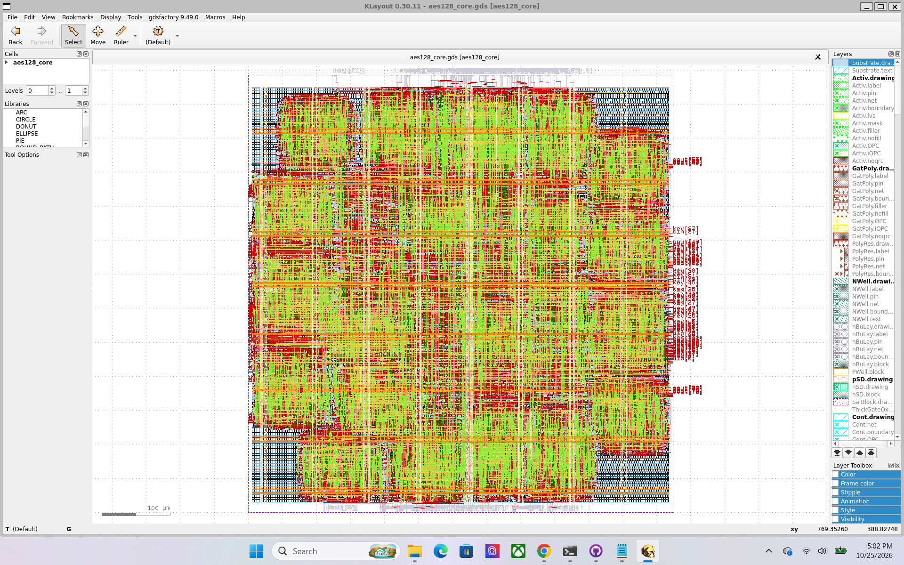
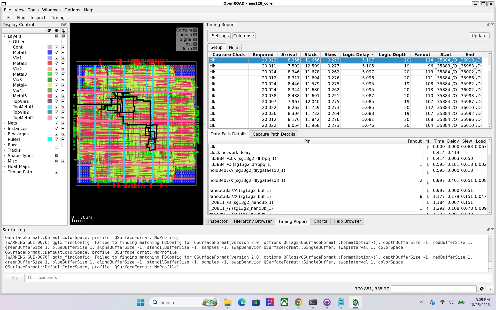

# 01 - AES-128 ma hoa + giai ma (IHP SG13G2, LibreLane)

Loi AES-128 lap 1 vong / chu ky, du lieu 128 bit, ho tro ca ma hoa va giai ma.

## Kien truc
- Ma hoa: 1 chu ky nap (din xor key) + 10 vong. Tu start den done: 11 chu ky.
- Giai ma: 10 chu ky tinh xuoi khoa toi vong 10, roi 10 vong giai ma. Tu start den done: 21 chu ky.
- Khoa vong tinh "on the fly" (khong luu 11 khoa). Khi giai ma, khoa duoc tinh nguoc:
  w3' = w3 ^ w2, w2' = w2 ^ w1, w1' = w1 ^ w0, w0' = w0 ^ SubWord(RotWord(w3')) ^ Rcon.
  4 S-box cua khoa dung chung cho ca hai chieu (chi doi dau vao w3 hay w3 ^ w2).
- 16 S-box + 16 S-box nghich cho du lieu. S-box sinh tu `gen.py` (nghich dao trong GF(2^8) + affine),
  khong chep bang tu ngoai vao; gen.py kiem tra S[0]=63, S[1]=7c, S[53]=ed.
- Cong: clk, rst_n (async, active low), start, decrypt, key[127:0], din[127:0] -> busy, done, dout[127:0].
  Byte dau tien o bit [127:120] (theo FIPS-197). Key va din chi can giu dung 1 chu ky luc start.

## Kiem tra
- `aes_tb.v`: 304 vector (FIPS-197 phu luc B va C.1, key/plaintext toan 0 va toan 1, 300 vector ngau nhien do
  thu vien Python `cryptography` tinh). Moi vector: ma hoa ra dung ct, giai ma ct ra dung pt, dung do tre,
  busy khong xuong som; them 1 phep thu `start` khi core dang ban phai bi bo qua.
- Thu dot bien (mutation) 9 loi chen co y: sai Rcon, sai ShiftRows, bo MixColumns sai vong, sai he so
  InvMixColumns, sai InvShiftRows, vong cuoi giai ma, khoa nguoc, sai 1 o S-box, bo AddRoundKey vong 10.
  Ca 9 deu bi testbench bat (FAIL).
- Yosys (tong hop generic) khong bao latch hay vong to hop (`check -assert` sach).

## Chay
```
./run_sim.sh          # mo phong, in AES128: PASS
./run_flow.sh 01_aes128   # LibreLane -> GDS (CLOCK_PERIOD 20 ns)
```

## Ket qua LibreLane (IHP SG13G2, CLOCK_PERIOD 20 ns)
| Chi so | Gia tri |
|---|---|
| So instance (gom ca cell filler va tap) | 44061 |
| Dien tich instance | 372451 um2 (khoang 0.37 mm2) |
| Setup slack xau nhat | +6.71 ns tai chu ky 20 ns (so xau nhat trong cac goc timing, suy luan la goc cham) |
| Hold slack xau nhat | +0.12 ns |
| Vi pham setup / hold / max slew / max cap | khong co |
| DRC / LVS / Antenna | Passed / Passed / Passed |

- Slack lay tu trang thai sau buoc 63 cua flow (sau routing va STA), cac buoc sau khong doi timing.
- Chua chay buoc kiem tra tuong duong (Yosys EQY), buoc nay mac dinh tat.
- Thoi gian chay tren may tac gia: khoang 1 gio 45 phut den het routing (luc do may dang chay nhieu flow cung luc), them khoang 16 phut cho DRC va LVS.
- File GDS va metrics.json nam trong thu muc results.

## Bien the: S-box dang truong ghep (composite field)

Ban goc dung S-box bang tra 256 muc. Bien the nay tinh S-box bang so hoc truong ghep GF((2^4)^2):
chuyen byte sang truong ghep bang phep bien doi tuyen tinh, nghich dao nho GF(2^4) (bang 16 muc),
roi chuyen nguoc va ap phep affine. Ca S-box thuan va nghich deu viet theo cach nay.

- Sinh bang `gen_comp.py` (tu tim ma tran chuyen truong, khong chep bang ngoai). Dong cau nhan duoc kiem tra truoc khi sinh Verilog.
- Kiem chung: so khop vet can 256 gia tri, ca hai chieu, voi S-box bang tra; AES van qua 304 vector khi dung S-box nay.
  Dot bien (sai 1 bit ma tran, sai hang so 0x63) deu bi bat.
- Chay flow: `librelane --pdk-root /opt/pdks --manual-pdk --pdk ihp-sg13g2 --run-tag comp config_comp.yaml`

| Chi so | S-box bang tra | S-box composite |
|---|---|---|
| So instance | 44061 | chua chay |
| Dien tich instance (um2) | 372451 | chua chay |
| Setup slack xau nhat (ns, 20 ns) | +6.71 | chua chay |
| Hold slack xau nhat (ns) | +0.12 | chua chay |

- Chua biet bien the nao nho hon sau LibreLane: dem cell cua Yosys generic (khong qua ABC) khong dai dien cho dien tich that, nen khong dua so do vao day.
- Du doan (suy luan): diem manh la dien tich, diem yeu co the la duong logic sau hon nen setup giam.

## Hinh anh

Layout trong KLayout (toan chip):



Bao cao timing trong OpenROAD GUI:



- Anh timing la goc nom_typ_1p20V_25C (typical), sap xep theo logic delay giam dan trong cac duong dang liet ke (chua kiem tra toan bo cac duong cua thiet ke).
- Duong duoc chon la duong tu thanh ghi toi thanh ghi: 20 tang logic, logic delay 5.11 ns, arrival 8.36 ns, slack +11.67 ns o goc nay. Phan con lai cua arrival la tre day noi va clock network.
- Ten cell do cong cu dat tu dong (dang _35884_), nen khong doi chieu truc tiep ve ten bien trong RTL. Do sau 20 tang va fanout lon phu hop voi vong ma hoa (S-box, MixColumns), nhung day la suy luan, chua xac nhan.
- So +6.71 ns trong bang ket qua la goc xau nhat, nen khac so slack trong anh vi khac goc.
- Buffer chong hold (sg13g2_dlygate4sd3_1) do LibreLane tu chen xuat hien tren duong nay, binh thuong.

## Han che (thang that)
- Khong chong tan cong kenh ke (side channel), khong co che do CBC/CTR/GCM, chi ECB 1 khoi.
- Ban goc dung S-box bang tra (case); bien the composite field co kem theo, can chay flow moi biet dien tich that.
- Chua mo phong gate-level; SDC mac dinh cua LibreLane (input/output delay 20% chu ky), nen slack duong chua chung minh chip chay duoc tren board that.
- Setup slack du lon cho thay co the thu CLOCK_PERIOD nho hon (vi du 15 ns), nhung chua chay thu. Luu y input/output delay cua SDC mac dinh la 20% chu ky nen cung doi theo chu ky, vi vay slack khong giam tuyen tinh.
